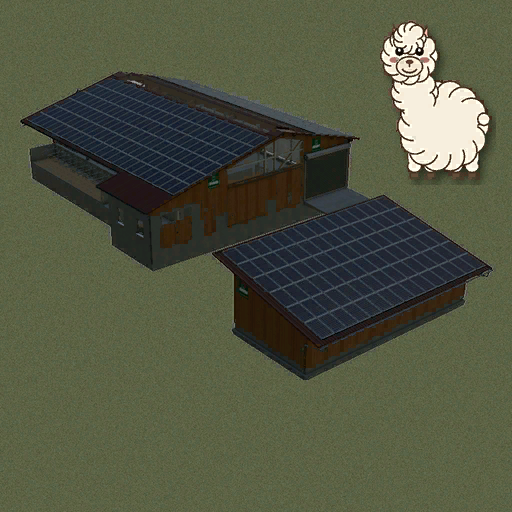

# ModHub upload: Alpaca PRX500

What to enter in the GIANTS ModHub upload form for this mod. Each text box below has a copy button on GitHub.



**Mod Icon (512x512):** [`icon_512.png`](icon_512.png)

| Field | Value |
|-------|-------|
| Title English | Alpaca PRX500 |
| Title German | Alpaca PRX500 |
| Title French | Alpaca PRX500 |
| Version | `1` `17` `2` `2` |
| Author | DTM Mods, PropaineX |
| Manufacturer | Rudolf Hörmann |
| Category 1 | Placeable > Animal Pens |
| Category 2 | Not Set |
| Category 3 | Not Set |

## Title English
```text
Alpaca PRX500
```

## Title German
```text
Alpaca PRX500
```

## Title French
```text
Alpaca PRX500
```

## Description English
```text
Alpaca PRX500 is a large alpaca barn built on the base-game Hörmann barn, with its own covered fleece pallet shed beside it. It holds at least 100 alpacas and comes with a pasture you can customize when you place it. Requires the Beans & Alpacas DLC.

- Shearing spot in the old milking stall, furnished as a shearing room
- Fleece comes out as pallets in an open wooden garage next to the barn, on 6 rows, stacking 2 high
- Pallet size 2,000 l or 5,000 l, chosen at the control cabinet in the old milk-cooler room
- Food: grass and hay, the same as sheep on the map (alfalfa, clover and map crops included), 360,000 l; hay adds up to +5% fleece output
- Straw bedding: 120,000 l, used daily at the pig rate; production 110% when full, falling to 85% when empty
- Automatic water supply (you pay for the water used); no milk, slurry or manure
- Optional solar panels on the barn and the garage, 13 colour choices
- Price 268,200, upkeep 268 per day

How to use: Shop > Animal Pens > Alpacas. Press R at the cabinet to change the pallet size. While this mod is loaded, its food rules apply to every alpaca barn on the map.

Changelog 1.17.2.2:
- First public release.
- Translated into all 27 game languages: description, shop texts and the pallet size menu.
- Less output in the game log: only a one-line food summary at map load and real warnings.
```

## Description German
```text
Alpaca PRX500 ist ein großer Alpakastall auf Basis des Hörmann-Stalls aus dem Grundspiel, mit eigenem überdachtem Unterstand für Wollpaletten daneben. Er fasst mindestens 100 Alpakas und hat eine Weide, die du beim Platzieren anpassen kannst. Benötigt den Beans & Alpacas DLC.

- Scherplatz im alten Melkstand, als Scherraum eingerichtet
- Die Alpakawolle kommt als Paletten in einer offenen Holzgarage neben dem Stall heraus, auf 6 Reihen, 2 hoch stapelbar
- Palettengröße 2.000 l oder 5.000 l, wählbar am Schaltschrank im alten Milchkühlraum
- Futter: Gras und Heu wie bei den Schafen der Karte (auch Luzerne, Klee und Kartenfrüchte), 360.000 l; Heu bringt bis zu +5 % Wolle
- Stroh-Einstreu: 120.000 l, täglicher Verbrauch wie bei Schweinen; Produktivität 110 % bei vollem Lager, sinkt auf 85 % wenn leer
- Automatische Wasserversorgung (das Wasser wird bezahlt); keine Milch, keine Gülle, kein Mist
- Solaranlage auf Stall und Garage als Option, 13 Farben zur Auswahl
- Preis 268.200, Unterhalt 268 pro Tag

Bedienung: Shop > Tiergehege > Alpakas. Am Schaltschrank R drücken, um die Palettengröße zu ändern. Solange dieser Mod aktiv ist, gelten seine Futterregeln für alle Alpakaställe auf der Karte.

Changelog 1.17.2.2:
- Erste öffentliche Version.
- In alle 27 Sprachen des Spiels übersetzt: Beschreibung, Shop-Texte und das Menü für die Palettengröße.
- Weniger Einträge im Log: nur eine Zeile zum Futter beim Laden der Karte und echte Warnungen.
```

## Description French
```text
Alpaca PRX500 est une grande étable à alpagas construite sur l'étable Hörmann du jeu de base, avec son propre abri couvert pour les palettes de laine. Elle accueille au moins 100 alpagas et dispose d'un pâturage que vous pouvez personnaliser en la plaçant. Nécessite le DLC Beans & Alpacas.

- Poste de tonte dans l'ancienne salle de traite, aménagée en salle de tonte
- La laine d'alpaga sort en palettes dans un garage ouvert en bois à côté de l'étable, sur 6 rangées, empilables sur 2 niveaux
- Palettes de 2 000 l ou 5 000 l, au choix à l'armoire électrique de l'ancien local du tank à lait
- Nourriture : herbe et foin, comme les moutons de la carte (luzerne, trèfle et cultures de la carte compris), 360 000 l ; le foin donne jusqu'à +5 % de laine
- Litière de paille : 120 000 l, consommée chaque jour comme pour les porcs ; productivité 110 % quand elle est pleine, jusqu'à 85 % quand elle est vide
- Eau automatique (l'eau consommée est payante) ; pas de lait, ni lisier, ni fumier
- Panneaux solaires en option sur l'étable et le garage, 13 couleurs au choix
- Prix 268 200, entretien 268 par jour

Utilisation : Boutique > Enclos > Alpagas. Appuyez sur R devant l'armoire pour changer la taille des palettes. Tant que ce mod est chargé, ses règles de nourriture s'appliquent à toutes les étables à alpagas de la carte.

Changelog 1.17.2.2 :
- Première version publique.
- Traduit dans les 27 langues du jeu : description, textes de la boutique et menu de taille des palettes.
- Journal du jeu allégé : un résumé de la nourriture au chargement de la carte et les vrais avertissements.
```

## Before uploading

- ModHub fills the Description boxes from modDesc.xml, which has descriptions in all 27 game languages (without the changelog); the form only takes English, German and French. Paste the full texts above (with the changelog) over them.
- While the mod is loaded, it changes the food (grass, hay, meadow) of every alpaca barn on the map, including the DLC's own barns. Your decision whether that is acceptable for a ModHub placeable; testers may flag it.
